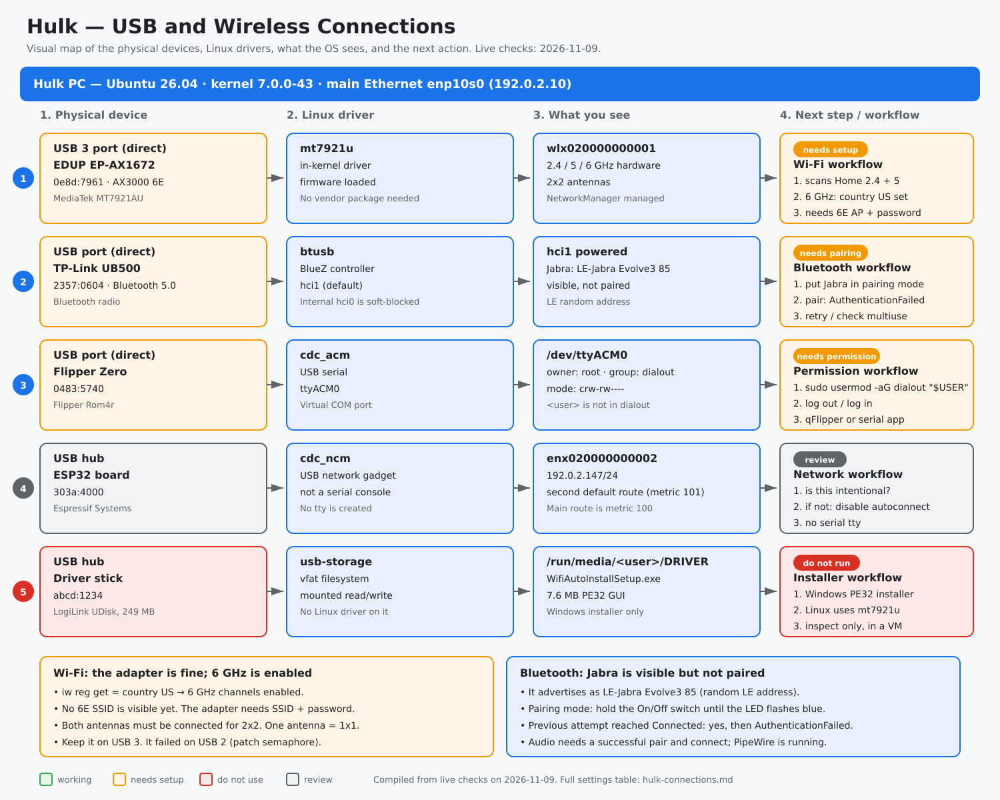

# Hulk USB and wireless connections

Compiled from the 2026-11-09 live USB, Wi-Fi, Bluetooth, and serial capture. This public copy replaces the host and user names, MAC addresses, IP addresses, SSIDs, and device paths with documentation values.

## Source

- Raw: [`../raw/hulk-usb-connections-2026-11-09.txt`](../raw/hulk-usb-connections-2026-11-09.txt)
- Capture date `2026-11-09`
- Kernel `7.0.0-43-generic`
- Platform `Ubuntu 26.04.1 LTS`, `x86_64`
- Visual map: [`hulk-connections-map.svg`](hulk-connections-map.svg)
- Interactive route map: [`../index.html`](../index.html)

## Visual map



[Open the interactive wiki route map](../index.html) to trace the wiki pages, raw sources, and hardware sections.

## Machine

| Field | Value |
| --- | --- |
| Host | demo |
| OS | Ubuntu 26.04.1 LTS |
| Kernel | 7.0.0-43-generic |
| Main Ethernet | `enp10s0`, `192.0.2.10/24`, default route metric 100 |
| Wi-Fi adapter | `wlx020000000001`, MediaTek MT7921AU |
| Bluetooth | `hci1` (TP-Link UB500); internal `hci0` soft-blocked |
| Serial | `ttyACM0` (Flipper Zero) |

## USB map

### Direct to the PC

| Bus / port | Device | USB ID | Driver | Interface | State |
| --- | --- | --- | --- | --- | --- |
| 006 / 001 | EDUP EP-AX1672 Wi-Fi 6E | `0e8d:7961` | `mt7921u` | `wlx020000000001` | Working on USB 3; not associated |
| 005 / 004 | TP-Link UB500 Bluetooth | `2357:0604` | `btusb` | `hci1` | Powered, default controller |
| 005 / 003 | Flipper Zero | `0483:5740` | `cdc_acm` | `ttyACM0` | Connected; serial permission issue |
| 001 / 005 | Internal IMC Bluetooth | `13d3:3571` | `btusb` | `hci0` | Soft-blocked |

### Through the Bridgesil hub

| Bus / port | Device | USB ID | Driver | Interface | State |
| --- | --- | --- | --- | --- | --- |
| 001 / 003.3 | “Driver” USB stick | `abcd:1234` | `usb-storage` | `/dev/sda1` | Mounted at `/run/media/<user>/DRIVER` |
| 001 / 003.4 | ESP32 board | `303a:4000` | `cdc_ncm` | `enx020000000002` | USB Ethernet; `192.0.2.147/24`; no tty |
| 002 / 003 | Hub Ethernet | `0bda:8153` | `r8152` | `enx020000000003` | Down / unavailable |

The hub appears twice because it has a USB 2.1 side (`35d6:2510`) and a USB 3.2 side (`35d6:3510`).

## Wi-Fi adapter

The adapter is a MediaTek MT7921AU in an EDUP EP-AX1672 shell. Linux uses the in-kernel `mt7921u` driver; the vendor driver stick is not needed.

| Setting | Current value | Meaning |
| --- | --- | --- |
| USB ID | `0e8d:7961` | MediaTek MT7921AU |
| Driver | `mt7921u` | In-kernel driver, version 7.0.0-43 |
| Firmware | `____010000-20260224110949` | Loaded successfully |
| Interface | `wlx020000000001` | NetworkManager-managed Wi-Fi interface |
| MAC | `02:00:00:00:00:01` | Local hardware address |
| USB bus | Bus 006, 5 Gbps | USB 3; keep it here |
| rfkill | `phy3`, soft blocked: no | Radio is enabled |
| Regulatory domain | `country US` | Set 2026-11-09; 6 GHz channels are enabled |
| Bands | 2.4 / 5 / 6 GHz hardware | 6 GHz channels enabled at 12 dBm; no 6E AP visible |
| Antennas | 2x2 (`TX 0x3`, `RX 0x3`) | Both antennas needed for full speed |
| Scan | Home 2.4 GHz ch 6; Home 5 GHz ch 157; Setup-AP | APs are visible |
| Association | None | No saved Wi-Fi profile or password |

### What this means

- The driver and radio are working. Scanning succeeds, and the adapter sees both 2.4 GHz and 5 GHz networks.
- 6 GHz is not broken hardware. The OS regulatory domain was `country 00`, so every 6 GHz channel was marked `(disabled)`. `sudo iw reg set US` was applied on 2026-11-09; `iw reg get` now reports `country US: DFS-FCC`, and the 6 GHz range `5925–7125 MHz` is present. The adapter’s 6 GHz channels now report 12 dBm instead of `(disabled)`.
- The raw capture below is from before the regulatory change. The table and this note reflect the later live check.
- No 6 GHz SSID is visible yet, so a 6E access point still needs to be enabled or brought into range before a 6 GHz connection can be tested.
- The adapter is 2x2. With one antenna connected it still works, but only at 1x1.
- The adapter initialized correctly on USB 3. An earlier attempt on USB 2 failed with `Failed to get patch semaphore`; keep it on the USB 3 port.
- The driver stick contains only `WifiAutoInstallSetup.exe`, a Windows PE32 installer. Do not run it on Hulk; the Linux driver is already active.

## Bluetooth

| Device | ID | Controller | State |
| --- | --- | --- | --- |
| TP-Link UB500 | `2357:0604` | `hci1`, default, powered | Working |
| Internal IMC radio | `13d3:3571` | `hci0`, soft-blocked | Disabled |
| Jabra Evolve3 85 | `02:00:00:00:00:0c` (LE random) | `LE-Jabra Evolve3 85` | Visible, not paired |

Pairing attempt:

```text
Attempting to pair with 02:00:00:00:00:0c
[CHG] Device 02:00:00:00:00:0c Connected: yes
Failed to pair: org.bluez.Error.AuthenticationFailed
[SIGNAL] LE.Disconnected - org.bluez.Reason.Local, Connection terminated by local host
```

The headset advertises as `LE-Jabra Evolve3 85`, which is the LE Audio advertisement. The previous attempt reached `Connected: yes` and then failed authentication. Put the headset into pairing mode before retrying: hold the On/Off switch on the left earcup in the Bluetooth position until the status LED flashes blue and the headset announces pairing mode.

## Flipper Zero serial port

| Field | Value |
| --- | --- |
| Device | Flipper Zero `0483:5740` |
| Serial device | `/dev/ttyACM0` |
| Stable path | `/dev/serial/by-id/usb-Flipper_Devices_Inc._Flipper_Rom4r_flip_Rom4r-if00` |
| Owner / group | `root:dialout` |
| Mode | `crw-rw----` |
| User groups | `<user>` is not in `dialout` |
| Result | A normal serial app will get permission denied |

`root` owns the device because it is a system device. `dialout` is the group that traditionally gets access to serial ports. Adding `<user>` to `dialout` is the usual fix; qFlipper’s udev rule is the narrower alternative.

## ESP32 board

| Field | Value |
| --- | --- |
| Device | Espressif `303a:4000` |
| Driver | `cdc_ncm` |
| Interface | `enx020000000002` |
| IPv4 | `192.0.2.147/24` |
| Gateway | `192.0.2.1` |
| Default route | Yes, metric 101 |
| Serial tty | None |
| Meaning | USB network gadget, not a serial console |

The board is on the hub and is presenting a USB Ethernet interface. It got a DHCP address on the same LAN as the main Ethernet, so the PC has two interfaces on `192.0.2.0/24` and two default routes. The main Ethernet is still preferred (metric 100 vs 101), but traffic can fall back to the ESP32 if the main link drops.

## Settings that can change

| Setting | Current | Can change? | Should change? | How |
| --- | --- | --- | --- | --- |
| Wi-Fi regulatory domain | `country US` | Yes | Done; make persistent if it resets | `sudo iw reg set US` now, or enable the `iw-regdom.service` unit |
| Wi-Fi connection | Not connected | Yes | Yes, to use the adapter | Connect in Settings, or `nmcli device wifi connect "<SSID>" password "<password>" ifname wlx020000000001` |
| Wi-Fi antennas | Unknown from software | Yes, physically | Yes, both for 2x2 | Attach both external antennas |
| USB port | USB 3 | Yes | Keep USB 3 | Move it to a USB 3 port if it is ever on USB 2 |
| ESP32 USB network | DHCP, second route | Yes | Only if it is intentional | `nmcli connection modify "Wired connection 2" connection.autoconnect no` then `nmcli connection down "Wired connection 2"` |
| ESP32 IP | `192.0.2.147` | Yes | Not necessarily | DHCP lease, static IP, or disable the interface |
| ESP32 serial tty | None | Yes, with different firmware or bootloader mode | Only if you need serial/flashing | Reflash, or enter the board’s bootloader mode |
| Flipper permissions | `root:dialout` | Yes | Yes, if using qFlipper or serial | `sudo usermod -aG dialout "$USER"`, then log out and back in |
| Driver stick | Windows installer | Not needed | No | Do not run it; the kernel driver is already working |
| Jabra pairing | Not paired | Yes | Yes, to use the headset | Put the headset in pairing mode, then pair/connect |

## Probe notes

- Commands used: `lsusb`, `lsusb -t`, `ip`, `nmcli`, `rfkill`, `iw`, `bluetoothctl`, `lsblk`, `findmnt`, `file`, `getfacl`, `journalctl -k`.
- `dmesg` was restricted; kernel messages came from `journalctl -k`.
- `sudo` was not available in this session, so the regulatory-domain change and the `dialout` group change were not applied.
- No 6 GHz AP was visible. The band is disabled by the regulatory domain, so a 6 GHz scan could not be completed.
- Association and throughput were not tested because no Wi-Fi password/profile was provided.

## Open questions

- Which SSID should the adapter join, and is the password available?
- Are both EP-AX1672 antennas connected?
- Is the ESP32 USB network intentional, or should its second route be disabled?
- Should the Flipper serial permission be fixed now?
